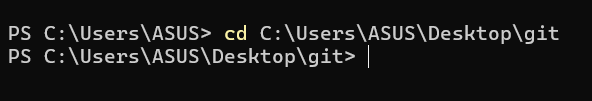
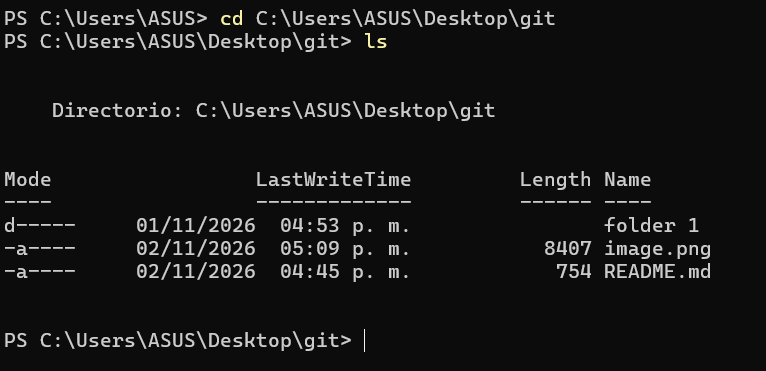
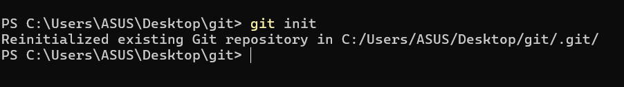
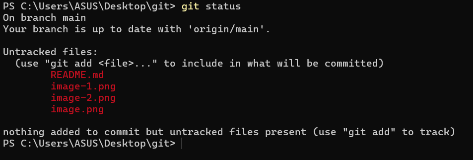
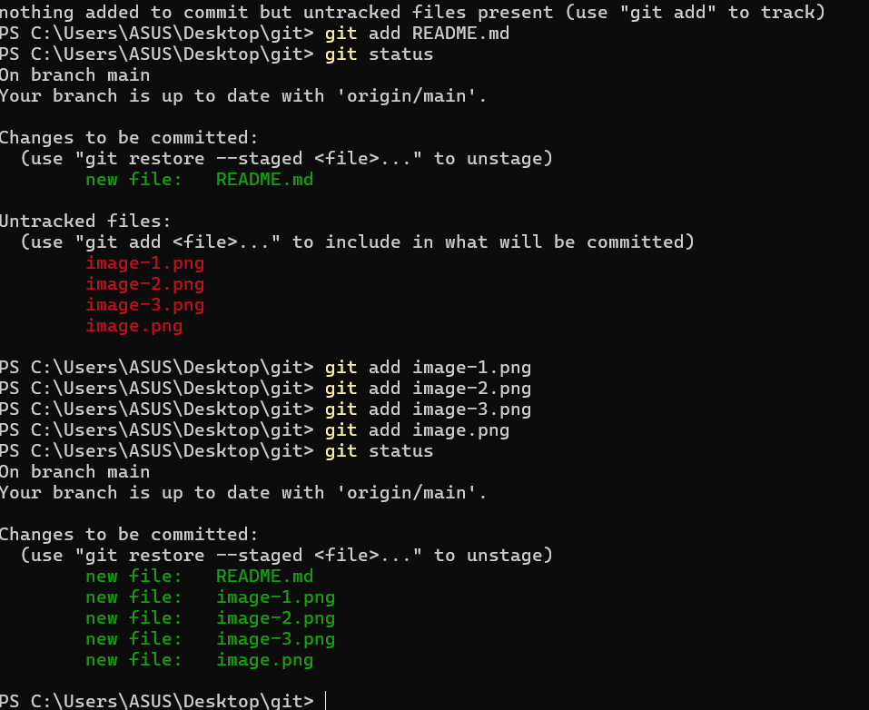
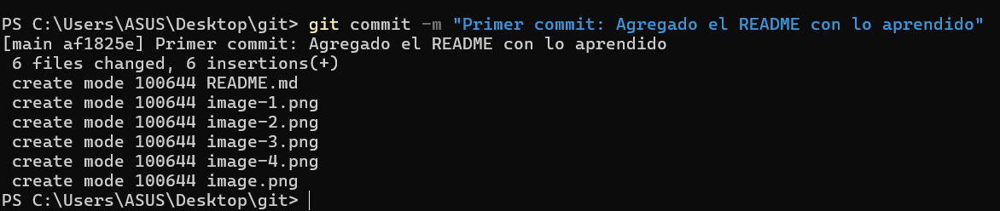
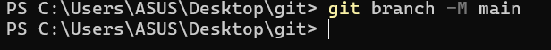
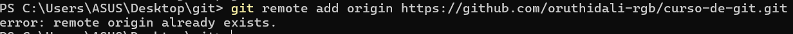
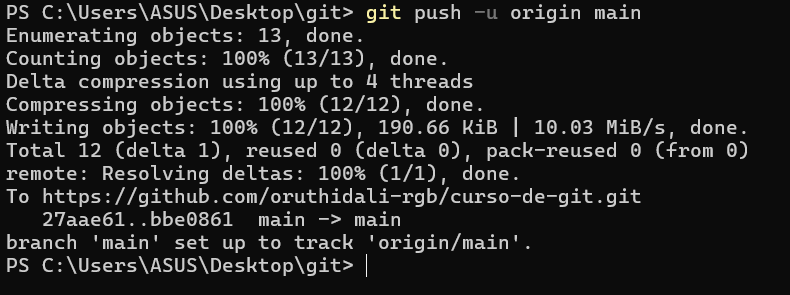

#¿Que aprendi del curso?
Concepto de Control de Versiones:La importancia fundamental de utilizar un Sistema de Control de Versiones (VCS) como Git, creado originalmente por Linus Torvalds en 2005, para administrar de forma limpia, segura y ordenada los cambios e historial de un proyecto de software a lo largo de su ciclo de vida.

Características Clave:La gestión eficiente de ramas (branches), la escalabilidad para proyectos grandes y el soporte robusto para la colaboración simultánea en equipo sobre un mismo código base.

Flujo de Trabajo Esencial: Se entendió cómo manejar proyectos con Git y GitHub, agregando archivos al área de preparación, realizando commits para guardar cambios y sincronizando todo con repositorios remotos.

Igual tome otro curso un poco mas largo donde aprendi a buscar los comandos y navegar desde la terminal por una carpeta, en ese tuve algunos problemas porque en un momento utilizo un comando que no reconocia mimterminal, asi que tuve que preguntar a Copilot y me explico que para mi terminal era dsitinto.

#¿Que comandos utilizaste?
Paso 1: Navegar a la carpeta del proyecto
    Se puede confirmar viendo la ruta al inicio de la línea. Si no es así, debes navegar hasta ella con el comando cd:

    

Paso 2: Puedes revisar los documentos o carpetas colocando ls:

    

Paso 3: Inicializar git en el repositorio local
    Ejecuta el comando init para crear el repositorio local de Git:

    

Paso 4: Verificar el estado de los archivos
    Para comprobar que Git detecta el archivo README.md con el comando status:

    

Paso 5: Preparar los archivos (Staging Area)
    Añadi todos los archivos de la carpeta actual al área de preparación con el comando add:

    

Paso 6: Guardar los cambios (commit)
     Primera instantánea del proyecto con un mensaje descriptivo con el comando commit -m:
     **Cuando ejecutas git add ., colocaste tu archivo README.md en una "zona de espera" (llamada Staging Area). El comando git commit toma todos los archivos que estaban en esa zona de espera y les toma una instantánea o foto permanente en la historia de tu proyecto.** No entendia para que servia por lo que utilice Gemini para que me explicara.

     

Paso 7: Conectar con GitHb y subir el proyecto
    Para esto primero me dirigi a Git para crear un repositorio llamado "curso_de_git" y luego seguir estos pasos:

        *Asegurar que la rama principal se llame main:

        

        *Vincular tu repositorio local con GitHub
        Este comando conecta la carpeta con el repositorio exacto que se creo en la web(remote add origin):

        

            Lo que muestra esta captura es que ya esta vinculado.

        *Subir los archivos a la nube (Hacer el Push):
        Finalmente, envie los archivos locales hacia GitHub con el comando push:

        

#¿Cómo verificar que funcionó?
Una vez que se ejecuto el último comando y termine de cargar, me dirigi al navegador web, actualice la página de mi repositorio y vi que mi archivo README.md y mis cambios ya aparecen publicados correctamente en la plataforma.

